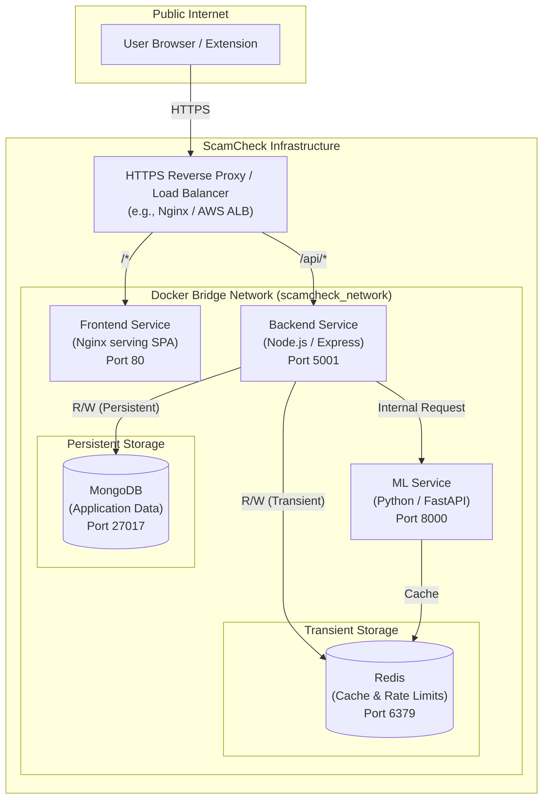

# ScamCheck Production Architecture

This document describes the high-level network topology, service separation, and data persistence guarantees in the ScamCheck production environment.

## Architecture Topology

## Service Classifications

### PUBLIC Services
These services handle ingress from the external internet.
1. **HTTPS Reverse Proxy (Ingress)**: Expected to terminate TLS (HTTPS). Routes `/api` traffic to the Backend and all other traffic to the Frontend.
2. **Frontend Service**: An Nginx server delivering static React SPA assets. It is publicly accessible (via Reverse Proxy), but executes client-side on the user's browser.
3. **Backend Service**: The Node.js Express API. Publicly accessible *only* via Reverse Proxy routing on specific endpoints. Enforces rate-limiting, CORS, and Authentication.

### INTERNAL Services
These services are STRICTLY protected within the internal Docker `scamcheck_network` and are NEVER exposed to the public internet or host machine interfaces.
1. **ML Service**: Python FastAPI application for LLM interaction and document extraction. Only reachable by the Backend.
2. **MongoDB**: The primary database. Stores Users, Profiles, and Reports permanently. 
3. **Redis**: In-memory data structure store. Stores transient pairing codes and API rate limits. 

## Storage & Persistence

1. **MongoDB Data**
   - **Type**: Persistent
   - **Mechanism**: Docker Volume (`mongodb_data:/data/db`)
   - **Guarantees**: Survives container restarts, host reboots, and image updates. Must be backed up explicitly.

2. **Redis Data**
   - **Type**: Transient
   - **Mechanism**: In-memory (No persistent volume mounted)
   - **Guarantees**: Does not survive container deletion. Rebuilding or restarting the Redis container will flush all active pairing codes and reset rate limits. This is intended operational behavior and does not result in application data loss.
